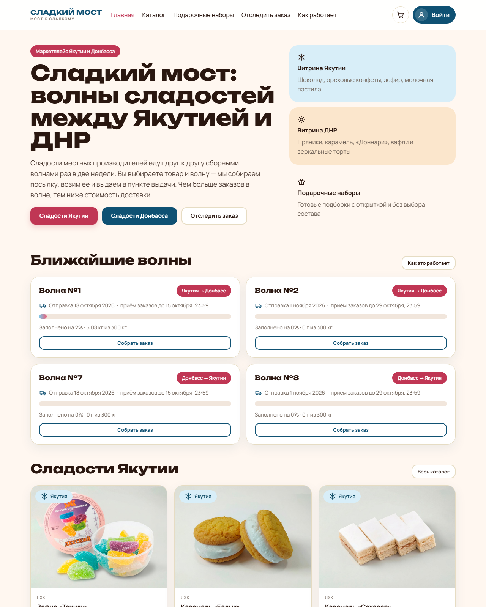
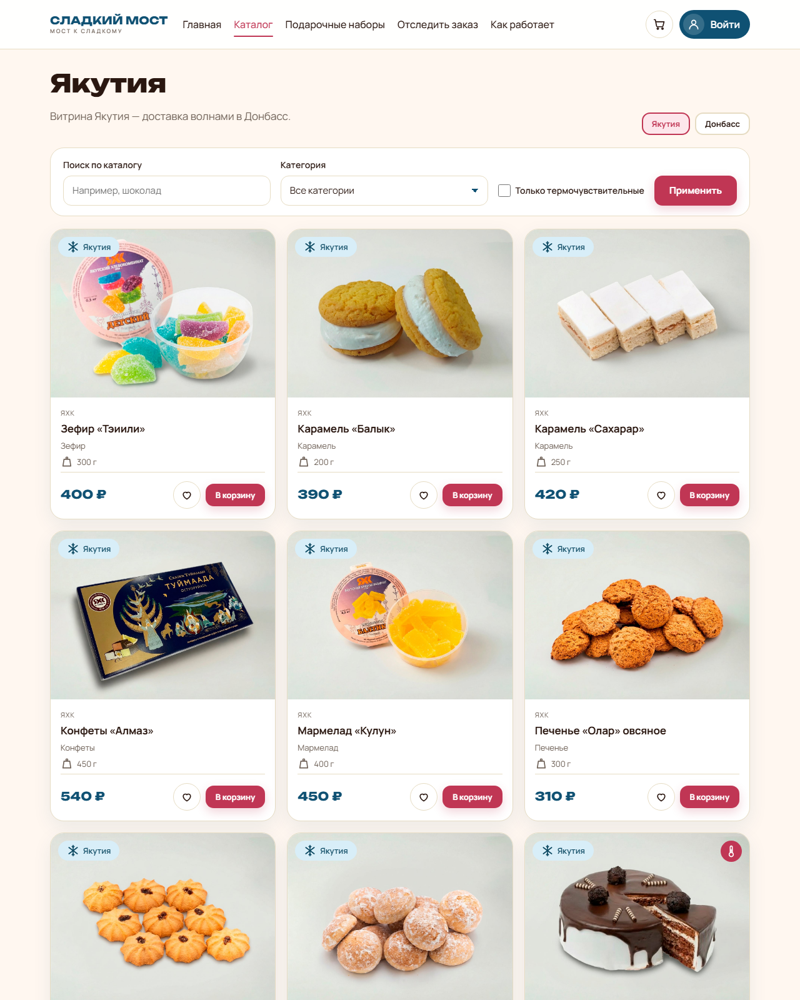
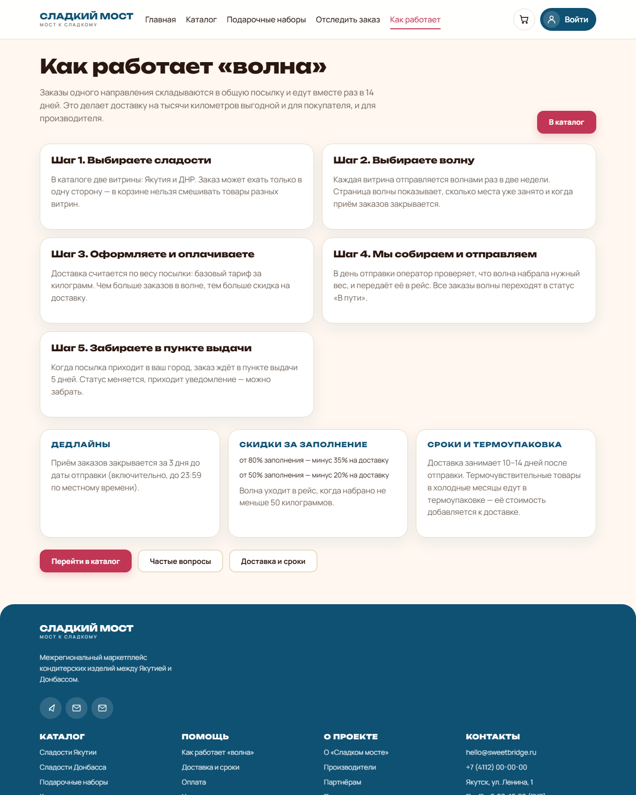
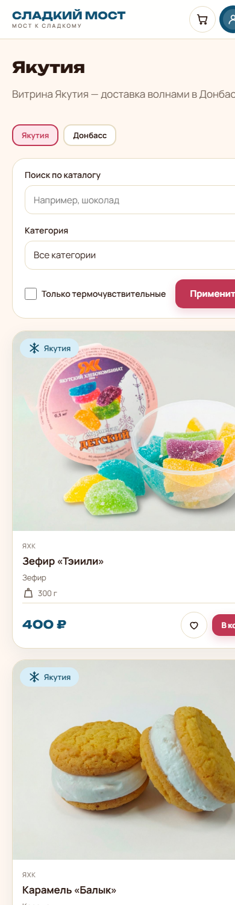
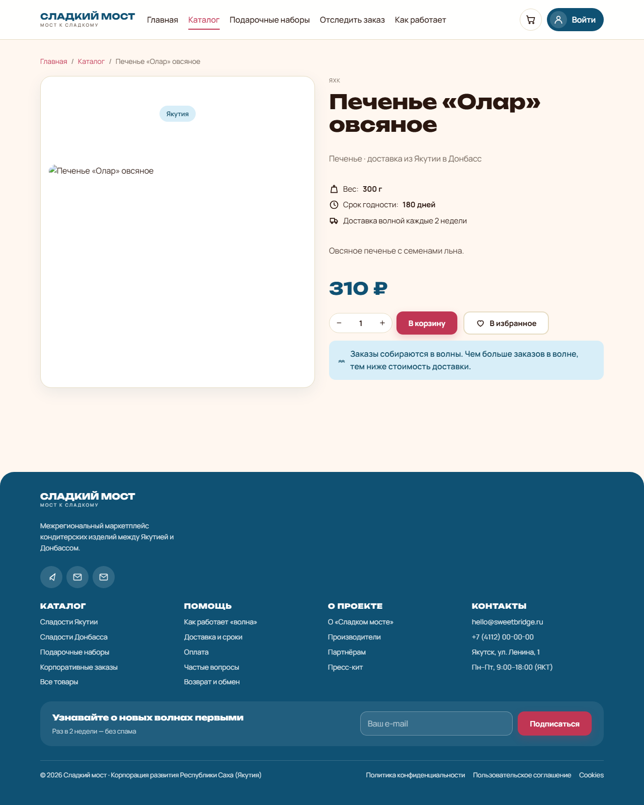
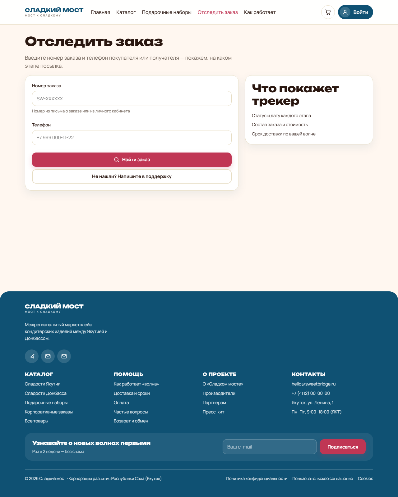
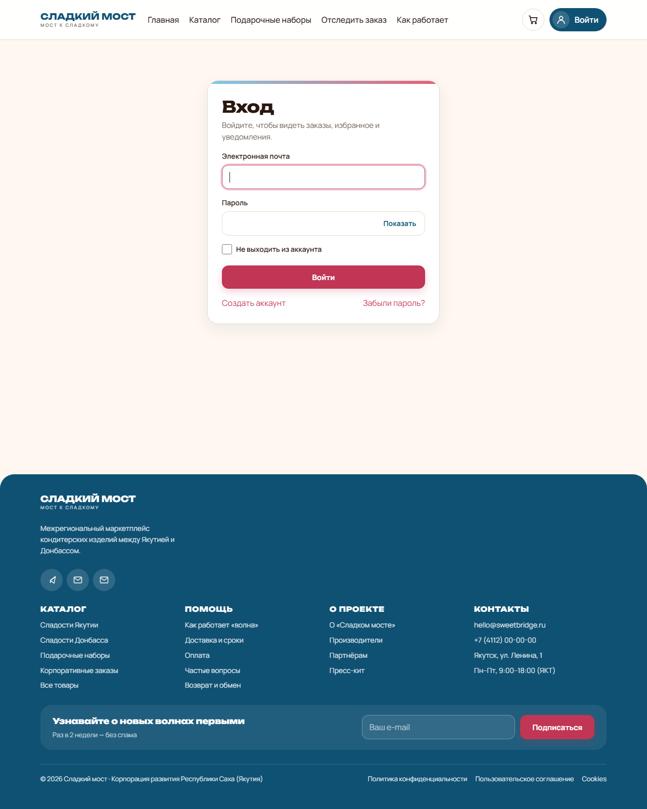

# Сладкий мост

Межрегиональный маркетплейс кондитерских изделий между Якутией и ДНР со сборными
доставками «волнами». Реализуется при поддержке Корпорации развития Республики Саха (Якутия).

Заказы одного направления складываются в общую посылку и едут вместе раз в две недели:
чем больше заказов в волне, тем ниже стоимость доставки для каждого.

| Главная | Витрина | Как работает «волна» | Мобильный вид |
|---|---|---|---|
|  |  |  |  |

## Возможности

- **Витрина с реальными фотографиями** изделий (с разрешения партнёра, импорт описан в [`docs/photo-import/README.md`](docs/photo-import/README.md)) по двум направлениям (Якутия → ДНР и ДНР → Якутия) с поиском, фильтрами по
  категории и термочувствительности, сортировкой и подгрузкой товаров без перезагрузки.
- **Волны** с датой отправки, дедлайном приёма заказов, полосой заполнения и порогами скидок.
- **Корзина и оформление**: подарок с открыткой, пункт выдачи, промокод, термоупаковка.
- **Оплата** демонстрационным шлюзом, **PDF-накладная** (QuestPDF) и **трекер заказа** по номеру и телефону.
- **Личный кабинет**: заказы, избранное, уведомления, профиль со сменой пароля.
- **Админка**: сводка, заказы, волны (создание и отправка), товары с загрузкой фото, промокоды,
  пункты выдачи, подарочные наборы, обращения и заявки, пользователи, журнал действий.
- **Вход через Mail.ru** — включается, когда заданы ключи приложения.

| Товар | Трекер заказа | Вход |
|---|---|---|
|  |  |  |

## Стек

- .NET 8 (net8.0), C# 13, ASP.NET Core Razor Pages
- EF Core 8 + SQLite (миграции применяются при старте)
- ASP.NET Core Identity: роли, регистрация, вход, восстановление пароля
- Bootstrap не используется: собственная дизайн-система на CSS-переменных
- Шрифты Unbounded и Manrope (локальные woff2, OFL)
- QuestPDF — накладная по заказу, MailKit — письма (по умолчанию outbox)
- xUnit — 81 тест: домен, логистика, сезонные правила и интеграционные проверки сайта

## Быстрый старт

```bash
dotnet restore
dotnet build
dotnet test
dotnet run --project src/SweetBridge.Web
```

Открыть <http://localhost:5000> (или адрес, напечатанный приложением). Проверка готовности: `GET /health`.

При первом старте создаётся база `src/SweetBridge.Web/App_Data/sweetbridge.db`,
импортируется каталог из `Infrastructure/Seeding/Data/catalog.csv`, создаются волны,
пункты выдачи, промокоды, подарочные наборы и администратор. Данные для демонстрации
создаются автоматически — ничего настраивать не нужно.

### Доступы

| Роль | Логин | Пароль |
|------|-------|--------|
| Администратор | `admin@sweetbridge.local` | `ChangeMe!2026` (или значение `Seed:AdminPassword`) |

Пароль администратора меняется через user-secrets:

```bash
cd src/SweetBridge.Web
dotnet user-secrets set "Seed:AdminPassword" "ваш-пароль"
```

### Что требует внешних ключей

| Возможность | Что нужно |
|-------------|-----------|
| Вход через Mail.ru | `ExternalAuth:MailRu:ClientId` и `ClientSecret` (user-secrets или переменные окружения) |
| Реальная оплата | заменить `IPaymentGateway` в `Services/ServiceCollectionExtensions.cs` на провайдера |
| Отправка писем почтой | `Email:Smtp:Host`, `Port`, `User`, `Password` (по умолчанию письма складываются в `App_Data/outbox`) |

## Структура

```
src/SweetBridge.Web
  Domain/          сущности, перечисления, value-objects, исключения домена
  Services/        прикладные сервисы: каталог, корзина, волны, заказы, промокоды,
                   избранное, уведомления, формы, аудит, письма, платежи, отчёты, контент
  Infrastructure/  EF Core (контекст, конфигурации, миграции), сидирование,
                   безопасность, фоновые задачи, health-check
  Pages/           Razor Pages: витрина, корзина, оформление, трекер, аккаунт, админка
  wwwroot/css/     fonts.css → site.css → components.css → layout-fixes.css
  wwwroot/js/      site.js (меню, трекер, пароли, прогресс), catalog-loader.js (подгрузка)
  wwwroot/fonts/   Unbounded и Manrope локально, внешние CDN запрещены политикой font-src
  wwwroot/images/products/  фотографии товаров (20 файлов, 2,5 МБ)
tests/SweetBridge.Tests
  Domain, Delivery, Services — модульные тесты
  Integration      — сквозные проверки через WebApplicationFactory
docs/              допущения, отчёт об исправлениях, скриншоты, схемы
```

## Сценарии

- **Гость**: каталог → корзина → оформление (подарок, пункт выдачи, промокод, термоупаковка) →
  оплата → трекер по номеру и телефону → PDF-накладная.
- **Покупатель**: регистрация → личный кабинет с заказами, избранным, уведомлениями и профилем →
  отмена и повтор заказа.
- **Администратор**: сводка, заказы, волны (создание и отправка), товары с загрузкой фото,
  промокоды, пункты выдачи, подарочные наборы, обращения и заявки, пользователи, журнал действий.

## Безопасность

- Строгая CSP и заголовки `X-Content-Type-Options`, `Referrer-Policy`, `Permissions-Policy`,
  `X-Frame-Options`, `Cross-Origin-Opener-Policy`; inline-скрипты и стили запрещены.
- Ограничение частоты: вход и регистрация, отслеживание заказа, формы, общий лимит (`RateLimits`).
- Antiforgery-токены на всех формах, блокировка учётной записи после 5 неудачных попыток.
- Загрузка изображений: только PNG/JPEG/WEBP, до 2 МБ, проверка сигнатуры файла, имя файла — GUID.
- Пароли не логируются, почта и телефон маскируются, ключи Data Protection хранятся в `App_Data/keys`.
- Вместимость волны защищена concurrency token, оформление заказа — одна транзакция с повтором при конфликте.

## Проверки

```bash
dotnet build -warnaserror   # 0 ошибок, 0 предупреждений (TreatWarningsAsErrors=true)
dotnet test                 # 81 тест, все зелёные
```

Дополнительно: Lighthouse по 8 страницам — accessibility 1.0, best-practices 1.0, SEO 1.0;
в браузере проверяются фильтры каталога, подгрузка товаров, поля пароля, меню и трекер заказа.
Подробности и доказательства — в [`docs/QA_REPORT.md`](docs/QA_REPORT.md).

## Документация

- [`docs/QA_REPORT.md`](docs/QA_REPORT.md) — что было сломано, как исправлено и чем проверено.
- [`docs/ASSUMPTIONS.md`](docs/ASSUMPTIONS.md) — допущения и принятые решения.
- [`docs/photo-import/README.md`](docs/photo-import/README.md) — как импортированы фотографии каталога.
- `docs/Схема работы продукта (User Flow).drawio` — схема пользовательского пути.
- `docs/*.docx` — отчёты предыдущей версии проекта (относятся к варианту SweetWave).

## Ограничения демо-режима

- Оплата проводится демонстрационным шлюзом, карточные данные не принимаются и не хранятся.
- Письма по умолчанию пишутся в `App_Data/outbox/*.eml` вместо отправки.
- Гостровая корзина не сливается с корзиной аккаунта при входе — это запланированное доработка.
- Фотографии товаров показывают упаковку партнёра, а названия в каталоге демонстрационные — перед публикацией либо переименовать позиции, либо заменить снимки своими ([`docs/photo-import/README.md`](docs/photo-import/README.md)).